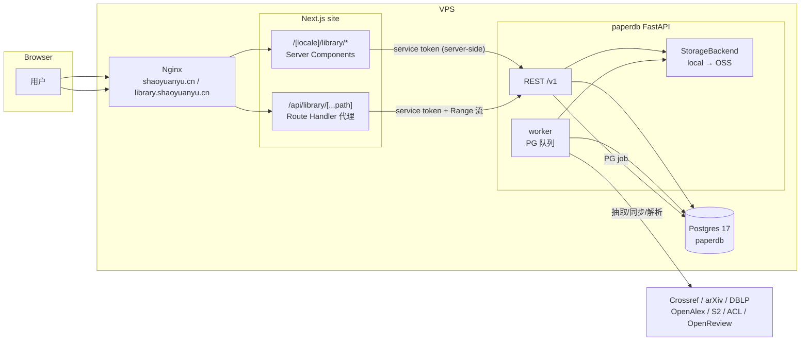

# paperdb · 计算机学术文献库（总览与决策）

> 状态：**v1.0 已确认** · 2026-11-24（仓库/域名、数据源、写作环境、阅读器范围已拍板）
> 后端仓库（待建）：`ysy-paperdb`，服务 `paperdb-api` / `paperdb-worker`
> API 域名（建议）：`library.shaoyuanyu.cn`，只提供 API，无网页 UI
> 前端仓库：`ysy-homepage-web`，新增 `/[locale]/library/*`

相关文档：

- [数据模型](data-model.md)
- [API 契约](api.md)
- [前端集成](frontend.md)
- [Agent 接口（MCP）](mcp.md)

> 评审建议：先看 §2（决策）与 §5.1–5.3（paper/venue/评价），再看 `frontend.md` §4（页面）；API 与表结构当参考手册按需查。

---

## 1. 一句话定位

**给一个计算机研究者自用的、比 Zotero 更贴合 CS 发表形态的文献库**：
以论文（不是 PDF 文件）为中心，把「会议/期刊、届次、track、CCF 等级、中科院分区、作者身份、预印本版本链、代码/数据 artifact」做成一等公民；同时把「待读 → 在读 → 已读 → 批注」的阅读流和「按项目导出 BibTeX」的写作流接在同一条数据链上。

它不是：

- 一个多用户文献管理 SaaS；
- 一个公开的论文搜索引擎；
- 一个 Zotero 的替代品（不追求导入 Zotero 全量数据、不做 CSL 引用处理器、不做浏览器插件）；
- 一个 AI 产品（v1 不做语义检索，只预留）。

### 1.1 为什么 Zotero 不够

| Zotero 的概念 | 问题 | paperdb 的做法 |
|---|---|---|
| Item（条目） | 论文、笔记、附件混在一个类型系统里；会议/期刊只是字符串字段 | `paper` 是唯一中心实体；`venue` / `venue_edition` / `track` 独立建模 |
| Item type | conferencePaper / journalArticle 太粗，"Findings""Workshop""Poster" 无处安放 | `paper.kind` + `venue` 层级 + `venue_edition.track` 三者表达 |
| Collection | 只有文件夹树，一篇进多个集合靠复制/手动 | 集合树 + 多对多 + 智能视图 + 项目工作区 |
| Tag | 扁平、无命名空间，几千条后不可用 | 命名空间 + 层级路径（`topic/llm/rag`）+ 批量治理 |
| Attachment | 附件与条目平级，PDF 无语义 | `pdf_file` 内容寻址、去重、逐页全文索引、批注锚定 |
| Saved search | 功能弱、不可分享 | 版本化 filter DSL，可存为视图、可进 URL |
| Better BibTeX | 外挂插件，citekey 与导出是补丁 | citekey 原生字段 + 按范围的可撤销 `.bib` URL |
| Extra 字段 | 任意字符串塞 DOI/arXiv/代码链接 | 多标识符表 + artifact 表 + 版本关系表 |
| 评价体系 | 无 | CCF / 中科院分区原生，带数据集版本标签 |

---

## 2. 已定决策（grill 结论）

| ID | 问题 | 结论 |
|---|---|---|
| D01 | 产品定位 | 管理与阅读流合一，**管理为底座**；引用/导出是核心，阅读状态与批注是上层 |
| D02 | 使用者 | **单主人**（不做多用户、不做配额/权限体系） |
| D03 | 公开性 | **v1 不公开**；不做公开集合页、不做公开只读 API；只在"以后"把精选条目喂给主页（届时再加） |
| D04 | 后端形态 | **纯 API**，无网页 UI；OpenAPI 3.1 为准；前端负责全部界面 |
| D05 | 认证 | 后端只认 **Bearer Token**；前端页面复用站点 TOTP 登录，由 Next 服务端持有 service token 调后端；个人脚本用个人 token；`.bib` 用独立的 export token |
| D06 | 部署 | **先同 VPS**（新增容器 + 独立 Postgres），但要能平移；独立子域；不碰 umami 的库 |
| D07 | 后台任务 | **不引入 Redis**；Postgres 队列 + 独立 worker 进程 |
| D08 | 文件存储 | 先本地磁盘，**内容寻址**（sha256）；`StorageBackend` 抽象，后续可切 OSS/S3，DB 只存 key |
| D09 | 规模 | 长期个人积累 **1w+ 条**，按 5w 条 / 数百 GB 留余量 |
| D10 | 评价体系 | CCF + 中科院分区两套；**只导入当前版**（CCF 2026、CAS 2025），但 schema/API 按多版本设计 |
| D11 | 组织工具 | 层级集合、命名空间层级标签、保存的智能视图、项目工作区、阅读状态/优先级/评分、自动归类规则、手动收藏与排序 |
| D12 | 元数据源 | Crossref、arXiv、DBLP、OpenAlex、Semantic Scholar；ACL Anthology / OpenReview 做专项适配 |
| D13 | PDF | 私有原件；允许"仅元数据"条目；PDF 全文检索；v1 不做 OCR；批注以页码+相对坐标+原文引文三重锚定 |
| D14 | 引用 | OpenAlex 为主、S2 为辅的外部引用图 + 本地"我引用了谁/谁引用了我的论文"台账 |
| D15 | 前端 | 列表（虚拟滚动/批量）、详情、内嵌 PDF 阅读器（**连续 + 双页 + 深色反色**）、导入、设置、Cmd+K；中英双语；桌面为主、手机可浏览 |
| D16 | 老页面 | **只新增，不改** `/publications`、`/ccf`、`/cas`、`/venues`；后端先成为新数据的真相源，老页面迁移另议 |
| D17 | AI | v1 不做；schema 预留 embedding 位置（pgvector 可随时加） |
| D18 | 交付 | **先设计文档确认，再开仓库写代码** |

### 2.1 两处需要显式记录的"软化"

1. **评价按年切换 vs 只导当前版**：数据只录当前版，所以 v1 的切换器里只有一个版本可切；导入时仍写 `valid_from = 数据集生效年`（CCF 2026→2026，CAS 2025→2025），因此早于该年的论文会命中"无当年数据 → 回退最新版"，UI 标 `fallback` 并显示数据集版本。补历史数据后，`resolve_rank` 会按论文发表年自动选中对应版本，不需要迁移表结构。界面必须**始终显示所用的数据集版本**，不允许无标签展示。
2. **引用图"两者都要" vs 未选"引用边多源并存"**：落库时一条 `(citing, cited)` 只保留**一行规范边**，`source` 记录权威来源（OpenAlex > S2 > 本地解析），`last_seen_at` 记录新鲜度；多源**计数**差异进 `citation_stat` 快照，不在边上堆多行。

---

## 3. 范围

### 3.1 v1 必须（上线自用的定义）

**文献数据**

- 粘贴 DOI / arXiv ID / 出版社 URL / 标题 → 解析候选 → 确认入库（含冲突提示）。
- 手动新建与编辑条目；多标识符（DOI/arXiv/DBLP/S2/OpenAlex/ACL/OpenReview）并存。
- 批量导入：标识符列表、`.bib`、拖入 PDF（能从首页抽 DOI 就解析，否则进 Inbox 待整理）。
- 去重与合并：标识符精确匹配优先，标题+年份+作者模糊匹配只作建议；合并保留别名与重定向。
- venue 归一：DBLP key 优先 → 规范化名精确匹配 → 别名表；未命中进"待整理"，不静默造重复。
- CCF 2026 与 CAS 2025 导入；论文/期刊徽章展示；会议不显示分区（分区表只覆盖期刊）。
- 作者实体：DBLP PID / ORCID / S2 / OpenAlex ID 锚定；本人（`is_me`）标记；作者顺序、通讯、共同一作。

**组织与阅读**

- 集合树（多对多）、命名空间层级标签、保存的智能视图（filter DSL）。
- 项目工作区：集合范围 + 置顶 + citekey 模板 + 导出 token。
- 阅读状态（queued/reading/read/skimmed）、优先级、评分、阅读进度、星标、手动排序。
- 自动归类规则：条件（复用 filter DSL）+ 动作（进集合/打标签），支持"对已有条目回放"。

**PDF 与批注**

- 上传 PDF（内容寻址、去重、大小上限）、仅元数据条目、主文件标记。
- 逐页文本抽取 + 全文检索（英文 FTS + trigram 兜底），命中定位到页码。
- 在线 pdf.js 阅读器；连续滚动 + 双页模式 + 深色反色；高亮/下划线/批注；页码 + 归一化坐标 + 引文锚定；批注列表面板。
- PDF 只经鉴权接口流式读取，支持 Range；绝不公开直链。

**引用与导出**

- OpenAlex/S2 引用关系同步；论文详情里"参考文献 / 被引 / 相关文献"。
- 引用关系（参考文献 / 被引 / 相关文献）；"相关"用共引 + 文献耦合。画布图是 M6 的可选增强，未完成则隐藏入口。
- citekey 自动生成（模板可配、冲突加后缀）；全库/集合/项目/视图导出 BibTeX。
- 可撤销的私密 `.bib` URL（Overleaf 可直接引用），带内容 ETag（条件请求 304），不依赖 Last-Modified；本地 LaTeX 用同一 URL 由脚本/CLI 定时拉取。
- CSL-JSON 导出（给 Pandoc/其他工具）。

**前端**

- `/library` 列表：虚拟滚动、筛选、排序、列、批量编辑、键盘流、URL 可分享状态。
- `/library/papers/[id]` 详情：元数据编辑、PDF 分栏、批注、引用、版本、artifact。
- `/library/import`、`/library/settings`、Cmd+K 全局检索。
- 中英双语文案；桌面优先；手机只读可浏览。
- 全部页面 `requireOwner()`，不登录不可见。

### 3.2 v1.5（明确排后）

- 公开精选集合（主页取数）。
- 笔记系统（条目笔记/独立笔记/双链）。
- 批注导出 Markdown、批注标签与颜色筛选。
- OCR 扫描件。
- 语义检索（pgvector）与自动摘要。
- 浏览器快捷收藏（书签脚本或扩展）。
- 历史 CCF/CAS 版本数据。
- 会议 deadline 与文献库联动（站点已有 `/deadlines`）。

### 3.3 非目标（不做）

- 多用户/团队/共享编辑。
- CSL 引用格式化引擎（只导出 CSL-JSON，格式化交给 citeproc/Pandoc/LaTeX）。
- 与 Zotero 双向同步、Zotero Web API 兼容。
- 论文全文 PDF 的公开分发（版权与隐私）。
- 移动原生 App。
- 成为领域级公共索引（数据源与 ToS 都不支持）。

---

## 4. 架构总览



### 4.1 三条请求路径

1. **页面渲染（SSR）**：浏览器 → Next 页面（先 `requireOwner()`）→ 服务端 `fetch` 带 `Authorization: Bearer $PAPERDB_SERVICE_TOKEN` → FastAPI → Postgres。浏览器永远看不到 token。
2. **浏览器里的增删改与 PDF 流**：浏览器 → Next `/api/library/[...path]`（校验 owner cookie）→ 注入 service token → 转发到 FastAPI。PDF 响应原样透传 `Range` / `Content-Range` / `Content-Type`，阅读器按需拉取分片。
3. **脚本/其他前端/Overleaf**：直接访问 `https://library.shaoyuanyu.cn/v1/...`，带个人 token；`.bib` 走 `/v1/exports/bib/<export_token>.bib`，URL 本身即凭证。

### 4.2 为什么后端"纯 API"仍要有独立域名

- 个人脚本、CLI、以后的前端可以直接调，不必经过主页；
- OpenAPI 可被工具消费；
- 但**不提供网页 UI**、不做登录页、不发 cookie——攻击面比"自带一套登录 UI"小；
- 默认关闭 CORS；如以后要浏览器直连，再按 origin 白名单开。

---

## 5. 核心设计

### 5.1 论文身份：paper 不是 PDF

- 一篇论文 = 一行 `paper`；可以有 0..n 个 `pdf_file`（正式版、arXiv 版、补充材料）。
- 预印本与正式版是**两行 `paper`**，用 `paper_relation` 连接（`preprint_of` / `published_version_of` / `extended_version_of`），而不是把 arXiv 链接塞进正式版字段。这样引用图、评价、导出各自有明确对象。
- 多标识符并存：同一行 `paper_identifier` 表可同时挂 DOI / arXiv / DBLP / S2 / OpenAlex / ACL / OpenReview。DOI 大小写、`https://doi.org/` 前缀、arXiv 版本号在写入时规范化。
- 合并论文时保留 `merge_redirect`，旧 ID 的 API 请求 308 到新 ID，避免书签/脚本断掉。

### 5.2 venue 是层级，不是字符串

三层：

1. `venue`：系列（NeurIPS、ACL、TPAMI），带缩写、全称、DBLP series key、CCF 领域、别名表、`parent_id`（workshop 挂在主会下）。
2. `venue_edition`：届次（NeurIPS 2025 / ACL 2025 Findings / ICML 2025 Workshop on X），带 `year`、`track`、DBLP edition key、会期、地点、官网。
3. `paper.venue_edition_id`：会议/ workshop 论文指向届次；期刊论文只指向 `venue`，卷期页存在 `paper.volume/issue/pages`。

这样"ACL 2025 Findings"不是字符串，而是 `(venue=ACL, year=2025, track=findings)`；"NeurIPS 2025 Workshop on X"是主会下的子 venue + 自己的 edition。查询/筛选/评价都不用解析字符串。

### 5.3 评价体系：两套体系、两种粒度、一个版本标签

| | CCF | 中科院分区 |
|---|---|---|
| 覆盖 | 会议 + 期刊 | **仅期刊**（JCR） |
| 粒度 | A/B/C + 10 个领域 | 大类 1–4 区 + 小类分区 + Top 标识 |
| 数据版本 | 2026（第七版），`dataset_version='2026'` | 2025 升级版，`dataset_version='2025'` |
| 会议怎么显示 | 徽章 `CCF A` | 显示 `—`，tooltip 写明"分区表仅覆盖期刊" |
| 期刊怎么显示 | 徽章 `CCF A` | 徽章 `中科院 1 区 Top` + 小类 tooltip |

- 两套体系的"领域"不强行对齐：CCF 用官方 10 领域，CAS 用大类/小类学科；筛选器可以分别筛。
- CCF 领域在库内同时保存**全称**（`计算机体系结构/并行与分布计算/存储系统`）与**短键**（`计算机体系结构`）：展示用全称，筛选/分组用短键，避免页面重复长串。
- `venue_rank` 带 `dataset_version` + `valid_from/valid_to`；解析顺序：**论文发表年适用的版本 → 最近可用版本（标 fallback）→ 无**，返回值永远带 `dataset_version` 供 UI 展示。
- 只导入当前版时，界面不出现"版本切换"下拉；早于该版本的论文标 fallback。数据补齐后按发表年自动匹配。
- 数据来自后端仓库内 `datasets/ccf-2026.json`、`datasets/cas-2025.json`（从现有前端仓库复制并记录 checksum），由 `paperdb datasets import` 幂等导入。
- 归并：CCF 用 **DBLP series key**，CAS 用 **ISSN + 规范刊名**，都只做精确匹配；CCF 期刊缺 ISSN 时用 OpenAlex/Crossref 回填，剩余差异走人工 crosswalk CSV；冲突/仅名称命中进"待整理"（算法见 data-model §6.6）。
- **迁移期注意**：`/ccf`、`/cas` 仍读前端静态 JSON，后端成为真相源后更新数据集要两边同步；等前端老页面迁到 API 再删前端副本（见 D16）。

### 5.4 作者：ID 锚定，名字只是展示

- `author` 表：`display_name` + `orcid` + `dblp_pid` + `s2_author_id` + `openalex_id` + `is_me`。
- `paper_author`：顺序、通讯作者、共同一作、发表时单位（字符串快照，不做机构实体）。
- 解析优先级：DBLP PID（来自 DBLP 记录）> ORCID（Crossref）> S2/OpenAlex ID > 同名+单位人工确认。
- 名字变体进 `author_alias`，用于搜索和后续自动匹配；绝不用名字做主键。
- 合并作者与合并论文同一套"重定向 + 审计"机制。

### 5.5 组织：四种正交的"归类"方式

| 方式 | 语义 | 典型用法 |
|---|---|---|
| 集合 `collection` | 层级、多对多、可手动排序 | "RAG / 评估 / 长上下文" 主题树 |
| 标签 `tag` | 命名空间 + 层级、跨集合 | `status:needs-repro`、`topic/llm/rag`、`read:deep` |
| 智能视图 `saved_view` | 保存的 filter DSL + 排序 + 列 | "CCF-A 且待读"、"本月新增"、"有 PDF 未读" |
| 项目 `project` | 写作工作区：集合子集 + 置顶 + citekey 模板 + 导出 | "KDD 2027 投稿"、"博士论文第 3 章" |

外加两个"状态"：

- `paper_state`：阅读状态、优先级、评分、进度、星标、最近打开、归档；
- `auto_rule`：条件 + 动作，导入/新建时执行，也可手动回放。

关键原则：**归类不复制论文**。一篇论文可以同时在 3 个集合、2 个项目、若干标签里，只有一份元数据、一份 PDF。

### 5.6 PDF、全文与批注

- 存储：`sha256` 内容寻址，`storage_key = sha256/ab/cd/<hash>.pdf`；DB 存 `(storage_backend, storage_key)`，不存绝对路径。切 OSS 是**一次性迁移**：复制 blob → 回填每行 backend/key → 双读校验 → 切写；不是只改配置。
- 上传：multipart，默认上限 200 MB；同 hash 直接复用（秒传），不同论文可共享同一物理文件但各自有 `pdf_file` 行（版权/来源元数据不同）。
- 删除：文件软删；主文件删除时自动提升下一个；物理 blob 由 `gc_blob` 延迟 7 天、按引用计数回收。
- 全文：worker 用 PyMuPDF 逐页抽取，写入 `pdf_page_text`；页码保留，搜索命中可直接跳到页。英文用 `english` 配置的 tsvector，中文/子串用 `pg_trgm` 兜底；扫描件（所有页都抽不出字符）自动标记 `text_status='ocr_needed'`，v1 不做 OCR。
- 批注：`page` + `rects`（相对页宽高的 0–1 坐标）+ `quote` + `prefix/suffix`。缩放、换设备、重新渲染都不丢；v1 批注**跟随具体文件版本**，上传新版 PDF 时旧文件与旧批注保留，自动重锚定排到 v1.5。
- 权限：PDF 字节只经 `/api/library/...` 代理流出，必须 owner cookie；不接受任何公开直链。数据库备份与文件目录都视为私密数据。

### 5.7 引用图：规范边 + 外部 stub + 快照

- `citation_edge(citing_paper_id, cited_paper_id)`：库内论文之间的边，唯一约束，`source` 取权威来源，`last_seen_at` 新鲜度。
- `external_work`：库外被引/引用作品（标题、年份、DOI、OpenAlex ID），用于画"邻居"而不把 1w 条变成 10w 条；点开可一键"加入库"。
- `citation_stat(paper_id, source, cited_by_count, as_of)`：计数快照，用于排序/展示，不参与关系。
- 同步：OpenAlex 批量拉 `referenced_works` + `cited_by`，S2 补 TLDR/影响力引用；本地台账来自自己论文的参考文献（Crossref/OpenAlex 的 reference list）。
- 相关文献：v1 用共引 + 文献耦合 + 同 venue 加权，SQL 直接算；图可视化是 v1 里风险最高的 UI，允许降级为"邻接列表 + 相关 Top 10"。

### 5.8 导入、citekey 与导出

- 添加单篇：`POST /v1/resolve` 只读预览（返回候选、冲突、venue 归一结果、命中的评价、疑似重复），用户确认后 `POST /v1/papers`。
- 批量：`POST /v1/imports/{identifiers,bibtex,pdf}` 创建 job，worker 逐条处理，前端轮询进度；每条失败可单独重试。
- citekey：默认模板 `{first_author_family}{year}{title_word:1}` → `yu2026interpretability`；模板可配、支持 `|lower` 等修饰；冲突自动 `a/b/c` 后缀；改名写 `citekey_history` 并给出 old→new 对照，**旧 `.tex` 不会被自动改写**（按对照手动替换；别名导出排 v1.5）。
- 导出范围：全库 / 集合（含子集合）/ 项目 / 智能视图；`GET /v1/exports/bib/<token>.bib` 无 header 认证，token 可撤销、可只读、可限定范围；ETag 由内容哈希生成，Overleaf 侧按需刷新。
- BibTeX 规则：会议 `@inproceedings` + `booktitle`，期刊 `@article` + `journal/volume/number/pages`，预印本 `@misc` + `eprint/archiveprefix`，学位论文 `@phdthesis`；转义 `& % # _`；按 citekey 排序保证 diff 稳定。

---

## 6. 技术栈与仓库

### 6.1 后端

| 层 | 选型 | 理由 |
|---|---|---|
| 语言 | Python 3.12+ | PDF/元数据生态最好；与用户选择一致 |
| Web | FastAPI + Pydantic v2 | OpenAPI 3.1 原生、异步、类型强 |
| ORM/迁移 | SQLAlchemy 2.0 async + asyncpg + Alembic | 成熟；迁移可审计 |
| DB | PostgreSQL 17 | FTS + trigram + JSONB + SKIP LOCKED；以后可加 pgvector |
| 队列 | Postgres 表 + 独立 worker（SKIP LOCKED） | 不引入 Redis；单机足够；可平滑换 arq |
| PDF | PyMuPDF (fitz) | 文本抽取快、坐标信息全 |
| HTTP | httpx + tenacity | 超时/重试/限速统一 |
| 校验/格式 | ruff + pyright + pytest | CI 门禁 |
| 包管理 | uv + `pyproject.toml` + `uv.lock` | 快、可复现 |
| 容器 | 多阶段 Dockerfile，非 root | 与 webmail 镜像风格一致 |

### 6.2 仓库结构（建议）

```text
ysy-paperdb/
├── pyproject.toml / uv.lock
├── Dockerfile
├── compose.yml                  # 本地开发：api + worker + db
├── alembic/
├── datasets/
│   ├── ccf-2026.json            # 从主仓库复制，checksum 固定
│   ├── cas-2025.json
│   ├── venue-crosswalk.csv      # CCF↔CAS 人工连接（ISSN/名称差异）
│   └── README.md
├── src/paperdb/
│   ├── main.py                  # FastAPI app factory
│   ├── config.py                # pydantic-settings
│   ├── db/                      # session / models / repositories
│   ├── api/v1/                  # routers + schemas + deps
│   ├── auth/                    # tokens / scopes / rate limit
│   ├── ingest/                  # crossref / arxiv / dblp / openalex / s2 / acl / openreview
│   ├── venues/                  # normalize / aliases / rank resolver / dataset import
│   ├── papers/                  # dedupe / merge / citekey / relation
│   ├── organize/                # collections / tags / views / projects / rules
│   ├── pdf/                     # upload / text extraction / anchors
│   ├── storage/                 # base.py / local.py / s3.py
│   ├── search/                  # fts / filter compiler / facets
│   ├── citations/               # sync / graph / related
│   ├── exports/                 # bibtex / csl-json / export tokens
│   └── jobs/                    # queue / worker / handlers
├── scripts/                     # 运维与一次性迁移
├── tests/                       # unit / integration / fixtures
└── docs/                        # 本设计文档迁移过来
```

### 6.3 前端新增（详见 frontend.md）

- 路由：`app/[locale]/library/{page,papers/[id],projects/[id],import,settings,graph}`；
- 代理：`app/api/library/[...path]/route.ts`（仿 `app/api/mail/[...path]/route.ts`，加 Range/流式）；
- 组件：`components/library/*`；
- 类型：`lib/library/schema.d.ts` 由 OpenAPI 生成；
- 文案：`messages/{zh,en}.json` 新增 `library` 命名空间；
- 导航：`components/layout/owner-nav-item.tsx` 增加主人专属入口（与 `/mail`、`/calendar` 同处）。

### 6.4 命名与部署

- 仓库：`ysy-paperdb`；镜像：ACR 同命名空间 `shaoyuanyu/ysy-paperdb`；
- compose 服务：`paperdb-api`、`paperdb-worker`、`paperdb-db`；卷 `paperdb-db`、`paperdb-files`；
- **网络**：paperdb 服务加入主页现有 compose 网络（生产上通常是 `ysy-homepage-web_web`；也可显式 `name: web` 的 external network）。Next 用 `PAPERDB_URL=http://paperdb-api:9720`。
  ⚠ **不要写 `127.0.0.1:9720`**：web 是容器，`127.0.0.1` 是它自己，不是宿主/API。若两个 stack 不共享网络，给 web 容器加 `--add-host=host.docker.internal:host-gateway` 并用 `http://host.docker.internal:9720`（v1 推荐共享网络）。
- Nginx：
  - `library.shaoyuanyu.cn` → `127.0.0.1:9720`，`client_max_body_size 200m`，`proxy_request_buffering off`。
  - **站点** `shaoyuanyu.cn` 的 `/api/library/` 也要 `client_max_body_size 200m`、`proxy_read_timeout 300s`、`proxy_request_buffering off`——浏览器上传走的是站点域名，不是 library 子域（现有 server block 是 40m，必须改）。
  - library 子域加 `proxy_set_header Cookie "";`，别把站点 session cookie 透给 API。
- 前端环境变量：`PAPERDB_URL=http://paperdb-api:9720`、`PAPERDB_SERVICE_TOKEN`；
- 后端环境变量见 api.md §2.5。

---

## 7. 安全与隐私

- **数据分级**：论文元数据、PDF、批注、阅读状态全为私密；不做任何匿名统计上传。
- **token 三类**：service（Next 服务端 → API，可读写，仅存于 Next 服务端 env）、personal（脚本/其他前端，可限定 scope）、export（只能读一个导出范围，URL 即凭证）。
- token 只存哈希（SHA-256 + pepper），前缀明文用于定位；支持过期、撤销、最后使用时间。personal/export 可单独撤销；service token 通过环境变量替换 + 重启（v1 不做零停机双 token）；pepper 轮换会让所有个人 token 失效，需重新签发。
- 后端不设登录页、不发 cookie，且**忽略**任何入站 `Cookie`；站点 session cookie 是 `.shaoyuanyu.cn` 域，会随请求到达 library 子域，Nginx 在 library 子域 `proxy_set_header Cookie "";` 剥离，`/api/library` 代理也不转发 cookie。CORS 默认关闭；Nginx 层限流 + API 层 per-token 限流。
- PDF 上传做类型嗅探（magic bytes）、大小限制、文件名不使用用户输入做路径；storage key 完全由服务端生成。
- `.bib` export token 会出现在 Overleaf/代理日志里：限定只读、可一键撤销、可选绑定范围，不能用于任何写操作。
- 备份文件视同私密数据；`pg_dump` 与 PDF 目录都不入 git。
- 审计：合并、删除、citekey 改名、token 创建/撤销写 `audit_log`。

---

## 8. 部署与运维

| 项 | 方案 |
|---|---|
| 机器 | 先与主页同 VPS；compose 独立 stack（或同一 compose 增加服务），端口只绑回环 |
| 网络 | 共享主页 compose 的 `web` network（`http://paperdb-api:9720`）；不共享时用 `host.docker.internal`，禁用 `127.0.0.1` |
| 上传 | 站点 `/api/library/` 与 library 子域都放宽到 200m、300s、关闭请求缓冲；只放宽这两个 location，不影响全站 |
| DB | 独立 `paperdb-db` 容器 + 命名卷；**不复用** umami 的 Postgres |
| 文件 | 命名卷 `paperdb-files`；目录按 sha256 分片；未来切 OSS 只换 backend |
| 反向代理 | Nginx 子域 + TLS；只暴露 `/v1/*`、`/healthz`、`/readyz`、`/openapi.json` |
| 备份 | 每日 `pg_dump -Fc` + 文件目录 `restic`/`rsync` 到另一处；保留 14 天 + 月度；每季度做一次恢复演练 |
| 可观测 | 结构化 JSON 日志（request id / job id）、`/healthz`（DB+存储）、`/readyz`、worker 心跳、失败 job 在设置页可见 |
| CI | `ruff` + `pyright` + `pytest` + `alembic check`；镜像由 ACR 按 `release-v*` 标签构建（与 `ysy-homepage-webmail` 同一套路） |
| 资源预估 | 1w 档：API 256–512 MB、worker 512 MB–1 GB（PyMuPDF）、PG 1 GB；5w 档：PG 2–4 GB，正文 trigram 需评估分区/降级；磁盘 = PDF 体积 × 2（备份另算） |
| 迁移 | compose + 卷 + dump 可整体搬走；所有路径/URL 走环境变量，无绝对路径硬编码 |

---

## 9. 里程碑（工作量是估算，不是承诺）

| 阶段 | 内容 | 估算 |
|---|---|---|
| **M0** | 本设计文档评审、仓库/域名/密钥确认 | 1–2 天 |
| **M1 地基** | 仓库、CI、配置、迁移、token 鉴权、storage 抽象、health、OpenAPI、papers/venues/authors 最小 CRUD、CCF/CAS 导入 | 1.5–2 周 |
| **M2 采集** | resolve（Crossref/arXiv/DBLP/OpenAlex/S2/ACL/OpenReview）、venue 归一、去重合并、BibTeX 导入、job+worker | 2 周 |
| **M3 组织** | 集合/标签/视图 DSL/项目/阅读状态/批量编辑/自动规则 | 1–1.5 周 |
| **M4 PDF 后端** | 上传、内容寻址、抽取、全文检索、Range 流、批注 API | 1.5–2 周 |
| **M5a 前端主线** | 列表、详情、导入、设置、Cmd+K、i18n、移动浏览（不含阅读器） | 2–2.5 周 |
| **M5b 阅读器** | pdf.js 渲染、连续/双页/深色反色、选择高亮、批注侧栏、页面搜索（依赖 M4） | 0.75–1.25 周 |
| **M6 引用** | OpenAlex/S2 同步、外部 stub、相关文献；画布图可选（可降级） | 1–1.5 周 |
| **M7 硬化** | 备份、监控、限流、性能、e2e、迁移演练 | 1 周 |

**建议的落地顺序**：M1 → M2 → M3 → M4（后端）→ M5a（与 M4 可并行）→ M5b → M6 → M7。先让"录入/检索/导出"与"列表/详情/导入"跑通，再接阅读器；PDF 与画布图是最大变量，不能拖垮主线。

### 9.1 测试策略

| 层 | 覆盖 |
|---|---|
| 单元 | venue/DOI/arXiv 归一、citekey 模板与冲突、filter DSL 编译、BibTeX 转义、rank 解析、去重打分、坐标映射（纯函数） |
| 集成（真 Postgres） | 迁移到空库、token scope 矩阵、分页/游标、乐观锁 409、合并重定向、导入 job 幂等、共享 blob 删除引用计数 |
| 适配器 | Crossref/arXiv/DBLP/OpenAlex/S2/ACL/OpenReview 的录制 fixture（vcrpy），错误/限流/缺字段分支 |
| PDF | 小样本 PDF 的抽取页数/文本、加密 PDF 拒绝、Range 206、超大文件 413 |
| 安全 | 撤销 token、错误 scope、路径穿越、公开 `.bib` 撤销、CORS 默认关闭 |
| 负载 | 1w 条合成数据：列表/搜索 p95、虚拟滚动帧率、PDF 首页时间 |
| 前端 | Playwright stub（见 frontend.md §12）+ 真机手测清单 |

---

## 10. v1 验收标准（Definition of Done）

1. 粘贴一个 **CCF-A 会议论文 DOI**，5 秒内出现条目草案，venue 自动归一并显示 `CCF A`；确认后入库。
2. 粘贴一个 **arXiv 链接**：建成 `kind='preprint'`、`venue=null` 的条目，不伪装 CCF 徽章；若检测到正式发表版本，显示 `venueSuggestion` 让用户确认/建立版本链。
3. 粘贴一个期刊 DOI，显示 `CCF` 与 `中科院 X 区` 两个徽章，并标明数据集版本；会议条目的 CAS 显示 `—` 且有"分区表仅覆盖期刊"提示。
4. 上传 20 MB PDF，30 秒内可搜到正文句子（`/v1/search/fulltext` 或阅读器内搜索），点击跳到对应页。
5. 在 PDF 上高亮，刷新、缩放、换窗口后位置不漂移；批注可改可删。
6. 建三级集合 + 两个命名空间标签 + 一个智能视图（"CCF-A 且待读"）；批量把 20 篇标为已读。
7. 建项目"KDD 2027"，把 `.bib` URL 填进 Overleaf，新增一篇后 Overleaf 重新编译能看到新条目；撤销 token 后 URL 立即失效。
8. 1w 条合成数据下：列表首屏 p95 < 300 ms，搜索 p95 < 200 ms，PDF 首屏 < 1 s（局域网）。
9. 手机浏览器能打开列表与详情、能读 PDF、能标已读；不出现横向溢出。
10. 全库导出 `.bib` 可被 `biber`/Overleaf 无警告解析；citekey 重名自动消解；空缩写 venue 不产生 `booktitle = { 2026}`。
11. 备份恢复演练：在新目录用 dump + 文件卷恢复后，随机 20 篇的 PDF/批注完整。
12. 既有页面零回归：`/publications`、`/ccf`、`/cas`、`/venues` 的构建与 e2e 全绿。
13. 站点未登录时 `/library` 与 `/api/library/*` 均 302/401，PDF 字节不可得；`/api/library/admin/*` 不可达。

---

## 11. 风险与缓解

| 风险 | 影响 | 缓解 |
|---|---|---|
| 范围过大（PDF 阅读器 + 引用图 + 批量导入同时做） | 长期不能上线 | 按 §9 顺序，先主线后增强；引用图允许降级为列表 |
| 元数据源限流/变更（S2、DBLP、ACM/IEEE） | 解析慢或失败 | 每源独立 adapter + 缓存 + 退避；失败可手动补；不把解析成功当入库前置条件 |
| venue 长尾归一错误 | 评价挂错 | DBLP key 优先；别名表可人工修正；未命中进"待整理"；合并可回滚 |
| CCF/CAS 数据版权与更新 | 不能公开分发 | 仅个人实例使用；数据文件不入公开镜像层；记录来源与 checksum |
| 中文全文检索弱 | 中文 PDF 搜不到 | v1 明确以英文为主；trigram 兜底；后续评估 zhparser/Meilisearch |
| PyMuPDF 是 **AGPL** | 将来开源/公开分发镜像时有许可证义务 | 个人自托管与私有镜像无碍；若要公开仓库/镜像，改用 `pypdf`/`pdfminer.six`（MIT/BSD）或购买商业许可（见 §6.1） |
| pdf.js 在 Next 15 / iOS Safari 的打包与内存 | 阅读器不可用 | 独立动态 import + worker 配置；移动端只读；准备"新标签页打开本地 PDF"降级 |
| 单 VPS 磁盘/内存 | PDF 增长后拖垮主页 | 独立卷 + 配额告警；storage 抽象随时切 OSS；可平移独立机 |
| 纯 Token 的泄露面 | 全库可读写 | service token 只在服务端；personal token 最小 scope；export token 只读可撤销；日志脱敏 |
| Postgres 队列的可观测性弱于 Redis | 卡 job 不自知 | `locked_at` 超时回收、失败重试上限、worker 心跳、设置页展示失败 job |

---

## 12. 开放问题（不阻塞文档评审，但动工前需要答案）

**已确认**：`ysy-paperdb` / `library.shaoyuanyu.cn`；ACR 沿用 `shaoyuanyu`；S2 无 key（1 rps）；OpenAlex/Crossref 的 `mailto` 先用占位 `me`；Overleaf 与本地 LaTeX 都要支持；PDF 双页 + 深色反色需要，画布图非必需。

仍需后续决定：

1. **文献范围**：中文期刊/会议、学位论文、书籍章节是否要正式支持？当前 schema 留了 `thesis`/`book_chapter`，但解析器只做英文源。
2. **"我的论文"**：是否需要一个显式的"我的作者档案"页（按 `is_me` 聚合、统计 CCF-A 数）？v1 只做字段，不做页面。
3. **历史评价数据**：以后补哪些年份？CCF 2019/2022、CAS 2020–2024 的来源是否已有？

---

## 13. 下一步

1. 你评审本目录四份文档，重点看：数据模型是否符合你的整理习惯、API 是否有缺、前端页面是否是你每天会用的形态。
2. §12 的仓库/域名/凭证/写作环境已确认；开始 `ysy-paperdb` M1（骨架、鉴权、数据集导入、最小 CRUD）。
3. M1 完成后先用真实 DOI/arXiv 跑 20 条，校准 venue 归一与评价展示，再进 M2。
