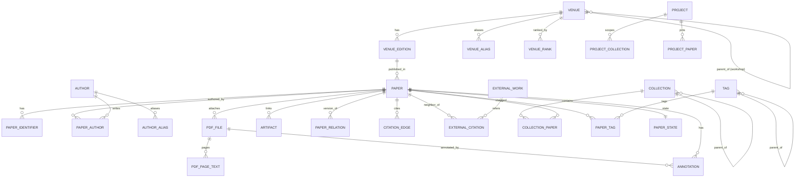

# paperdb · 数据模型

> 配套文档：[总览与决策](README.md) · [API 契约](api.md) · [前端集成](frontend.md)
> 状态：v0.1 待评审。这里的表名/字段名是**提案**，实现时以 Alembic 迁移为准。

---

## 1. 设计原则

1. **paper 是中心，PDF 是附件**：一篇论文可以没有 PDF，也可以有多份文件；元数据与文件解耦。
2. **计算机学术的"形状"进 schema**：venue 层级、届次、track、多标识符、版本链、artifact、CCF/CAS 都是结构化字段，不塞进 `extra`。
3. **评价带版本**：任何等级/分区都必须能回答"这是哪一年的目录"。
4. **归类不复制**：集合、标签、项目、视图都是"引用关系"，论文只有一份。
5. **可回滚**：合并、改名、删除都有重定向或审计；citekey 改名保留历史。
6. **先私有、后公开**：所有对象默认主人可见；没有 `is_public` 字段，公开能力将来以独立表/视图加，不污染核心表。
7. **Postgres 能算的就不要应用层算**：FTS、trigram、JSONB 过滤、队列、递归树。

---

## 2. ER 概览（核心）



`saved_view.filter` / `auto_rule.filter` 是 JSON（Filter DSL），不是表。

---

## 3. 枚举

| 枚举 | 取值 |
|---|---|
| `venue_kind` | `conference` / `journal` |
| `venue_status` | `provisional` / `confirmed` / `merged` |
| `edition_track` | `main` / `findings` / `demo` / `poster` / `doctoral` / `journal_track` / `companion` / `other` |
| `paper_kind` | `conference` / `journal` / `preprint` / `thesis` / `book_chapter` / `tech_report` |
| `identifier_scheme` | `doi` / `arxiv` / `dblp` / `s2` / `openalex` / `acl` / `openreview` / `pmid` / `isbn` / `other` |
| `rank_scheme` | `ccf` / `cas` |
| `rank_field_kind` | `ccf_field` / `cas_major` / `cas_minor` |
| `reading_status` | `unread` / `queued` / `reading` / `read` / `skimmed` |
| `annotation_kind` | `highlight` / `underline` / `note` / `region` |
| `relation_type` | `preprint_of` / `published_version_of` / `extended_version_of` / `erratum` / `replication` / `same_work` |
| `artifact_kind` | `code` / `dataset` / `model` / `demo` / `project` / `slides` / `poster` / `video` / `other` |
| `storage_backend` | `local` / `s3` / `oss` |
| `text_status` | `pending` / `extracted` / `ocr_needed` / `failed` |
| `job_status` | `pending` / `running` / `succeeded` / `failed` / `dead` |
| `import_kind` | `identifiers` / `bibtex` / `pdf` |
| `token_scope` | `papers:read` / `papers:write` / `organize:write` / `pdf:read` / `pdf:write` / `annotations:write` / `exports:read` / `admin` |

---

## 4. 表定义

> 约定：主键 `uuid` 默认 `gen_random_uuid()`；时间 `timestamptz`；软删除用 `deleted_at`；`updated_at` 由触发器维护。所有文本字段做长度约束（下文省略具体 length，实现时统一 `varchar(n)` 或 `text + check`）。

### 4.1 venue —— 会议/期刊系列

| 列 | 类型 | 说明 |
|---|---|---|
| `id` | uuid PK | |
| `kind` | venue_kind | 会议 / 期刊 |
| `abbrev` | text null | 缩写：`NeurIPS`、`TPAMI`、`ACL`；CCF 有 45 个期刊/1 个会议为空，存 NULL，不存空串 |
| `full_name` | text | 全称 |
| `normalized_name` | text | 归一化名（见 §6.1） |
| `parent_id` | uuid → venue | workshop/companion 挂在主会下 |
| `dblp_key` | text | 系列级 DBLP key：`conf/nips`、`journals/pami`；`venue_identifier(dblp)` 的冗余缓存 |
| `issn_print` | text null | 期刊 ISSN（`venue_identifier(issn)` 的冗余缓存；会议为空） |
| `issn_online` | text null | 期刊 eISSN |
| `homepage_url` | text | |
| `ccf_field` | text | CCF 官方领域**全称**（如 `计算机体系结构/并行与分布计算/存储系统`） |
| `ccf_field_key` | text | CCF 领域**短键**（首段，如 `计算机体系结构`），用于筛选/分组 |
| `status` | venue_status | `provisional` = 自动创建待确认 |
| `merged_into_id` | uuid → venue | 合并重定向 |
| `created_at` / `updated_at` | timestamptz | |

约束/索引：

- `unique (kind, normalized_name) where merged_into_id is null`
- `unique (dblp_key) where dblp_key is not null`
- `index (parent_id)`、`index (abbrev)`、`index (ccf_field_key)`
- `index (issn_print)`、`index (issn_online)`
- 触发器：`parent_id` 不得成环；父子 `kind` 必须一致（workshop 是 conference 的子级）。

### 4.2 venue_alias / venue_identifier —— 别名与跨源标识

`venue_alias`（非唯一、可一对多）：

| 列 | 类型 | 说明 |
|---|---|---|
| `id` | uuid PK | |
| `venue_id` | uuid → venue | |
| `alias` | text | 原始写法：`NIPS`、`Neural Information Processing Systems` |
| `normalized_alias` | text | 归一化 |
| `source` | text | `ccf` / `cas` / `dblp` / `manual` / `publisher` |
| `created_at` | timestamptz | |

- `unique (venue_id, normalized_alias)`
- `index (normalized_alias)`
- 用途：`NIPS → NeurIPS`、`ACL (1) → ACL`、出版社写法差异。手动新增别名优先于自动。
- 名字/缩写**不保证全局唯一**（CCF 里有空缩写、重复缩写），所以别名只用于"候选匹配"，不用于唯一连接。

`venue_identifier`（全局唯一，跨数据源连接键）：

| 列 | 类型 | 说明 |
|---|---|---|
| `id` | uuid PK | |
| `venue_id` | uuid → venue | |
| `source` | text | `dblp` / `issn` / `acl` / `openreview`（只放全局唯一键） |
| `value` | text | 原始值 |
| `normalized` | text | 归一化（DBLP series key 原样；ISSN 去连字符大写 X） |
| `is_primary` | boolean | 展示/解析优先 |
| `created_at` | timestamptz | |

- `unique (source, normalized)`；`index (venue_id)`
- **CCF 与 CAS 的桥**：CCF 提供 `dblp` key（缺 ISSN），CAS 提供 `issn`（缺 DBLP key）。两边通过 `venue_identifier` 挂到同一个 venue；CCF 期刊缺 ISSN 时用 OpenAlex/Crossref 回填一条 `issn`。
- `venue.dblp_key` / `issn_print` / `issn_online` 是 `is_primary` 标识符的**冗余缓存**，写入时同步；查询以标识符表为准。合并后的 venue 可能有多个 DBLP key，缓存只存主 key，其余在 `venue_identifier`。
- 期刊名/缩写进 `venue_alias`，不放进这里（会撞唯一约束）。

### 4.3 venue_edition —— 届次

| 列 | 类型 | 说明 |
|---|---|---|
| `id` | uuid PK | |
| `venue_id` | uuid → venue | |
| `year` | smallint | 2024 |
| `ordinal` | smallint null | 第 38 届（可空） |
| `track` | edition_track | 默认 `main` |
| `dblp_key` | text null | `conf/nips/2024`、`conf/acl/2024f` |
| `location` | text null | |
| `start_date` / `end_date` | date null | |
| `website_url` / `proceedings_url` | text null | |
| `is_primary` | boolean | 同名同年的主 track |
| `created_at` / `updated_at` | timestamptz | |

- `unique (venue_id, year, track)`
- `unique (dblp_key) where dblp_key is not null`
- `is_primary` 只表示默认展示的 track（同年可能有 main/findings/workshop），不参与唯一性；唯一键是 `(venue_id, year, track)`。
- 期刊没有 edition：期刊论文直接挂 `venue_id`，卷期页在 `paper` 上。

### 4.4 paper —— 论文

| 列 | 类型 | 说明 |
|---|---|---|
| `id` | uuid PK | |
| `kind` | paper_kind | 会议/期刊/预印本/学位论文/章节/技术报告 |
| `title` | text | |
| `title_normalized` | text | 去标点/小写/统一 unicode，用于去重 |
| `abstract` | text null | |
| `year` | smallint | 发表年（预印本为首发年） |
| `publication_date` | date null | 精确日期（有则用） |
| `venue_id` | uuid → venue null | 预印本可空；期刊/会议必填 |
| `venue_edition_id` | uuid → venue_edition null | 会议/workshop 用；期刊为空 |
| `volume` / `issue` / `pages` | text null | 期刊卷期页 |
| `institution` | text null | 学位论文学校/机构 |
| `citekey` | text | 稳定引用 key，唯一 |
| `language` | text | `en` / `zh` / … |
| `author_keywords` | text[] | 出版社给的关键词（非用户标签） |
| `paper_author_names` | text | 冗余作者名串（由 `paper_author` 维护），供 FTS 与列表展示；不替代关联表 |
| `urls` | jsonb | `{project, slides, video, poster, blog}` |
| `added_via` | text | `manual` / `doi` / `arxiv` / `bibtex` / `pdf` / `import` |
| `user_locked_fields` | text[] | 用户手改过的字段，enrich 不覆盖 |
| `citations_synced_at` | timestamptz null | 最近一次引用同步时间（增量调度用） |
| `version` | integer | 乐观锁 |
| `created_at` / `updated_at` / `deleted_at` | timestamptz | |

约束/索引：

- `unique (citekey) where deleted_at is null`
- `check (citekey ~ '^[a-z][a-z0-9]{0,63}$')`（生成/改名校验后只留小写字母数字）
- `check (kind <> 'journal' or (venue_id is not null and venue_edition_id is null))`
- `check (kind <> 'conference' or venue_id is not null)`
- `index (year)`、`index (venue_id, year)`、`index (venue_edition_id)`
- `index (created_at desc)`
- `GIN (title gin_trgm_ops)`、`GIN (search_tsv)`（见 §7）
- `paper_author_names` 由应用在作者变更事务内重建；不替代 `paper_author`。
- `paper_kind='conference'` 但 `venue_edition_id is null` 时置 `venue.status='provisional'` 或进"待整理"，不阻塞入库。

### 4.5 paper_identifier —— 多标识符

| 列 | 类型 | 说明 |
|---|---|---|
| `id` | uuid PK | |
| `paper_id` | uuid → paper | |
| `scheme` | identifier_scheme | |
| `raw_value` | text | 用户/来源原始值 |
| `normalized` | text | 归一化值（唯一键） |
| `is_primary` | boolean | 展示优先（DOI > arXiv > DBLP） |
| `source` | text | `crossref` / `arxiv` / `dblp` / `manual` … |
| `created_at` | timestamptz | |

- `unique (scheme, normalized)`
- `index (paper_id)`
- 归一化规则：
  - DOI：小写、去 `https://doi.org/`、去 `doi:` 前缀、URL decode。
  - arXiv：去 `arXiv:`、去版本号 `vN`，保留 `YYMM.NNNNN` 或旧式 `cs/0501001`。
  - OpenAlex：`W` + 数字，大写 W。
  - ACL：`2024.acl-long.1` 原样小写。
  - DBLP：`conf/nips/Foo24` 原样。
- 同一 paper 同一 scheme 允许多个值（如会议版与期刊版各有 DOI），但只一个 `is_primary`。

### 4.6 author / author_alias / paper_author

`author`：

| 列 | 类型 | 说明 |
|---|---|---|
| `id` | uuid PK | |
| `display_name` | text | 展示名（`Yu, Shaoyuan` 或中文名） |
| `family_name` / `given_name` | text null | 用于 citekey 与排序 |
| `orcid` | text null | `0000-0002-...` |
| `dblp_pid` | text null | `Y/Shaoyuan_Yu` 形式 |
| `s2_author_id` | text null | |
| `openalex_id` | text null | `A...` |
| `homepage_url` | text null | |
| `is_me` | boolean default false | 唯一一个 true（partial unique） |
| `status` | text | `provisional` / `confirmed` / `merged` |
| `merged_into_id` | uuid → author null | |
| `created_at` / `updated_at` | timestamptz | |

- `unique (orcid) where orcid is not null`
- `unique (dblp_pid) where dblp_pid is not null`
- `unique (is_me) where is_me`
- `index (lower(display_name))`

`author_alias`：`(id, author_id, name, normalized_name, source)`，`unique(author_id, normalized_name)`，`index(normalized_name)`。

`paper_author`：

| 列 | 类型 | 说明 |
|---|---|---|
| `paper_id` | uuid → paper | |
| `author_id` | uuid → author | |
| `position` | smallint | 从 1 开始 |
| `is_corresponding` | boolean | |
| `equal_contribution` | boolean | 共同一作 |
| `affiliation_text` | text null | 发表时单位快照 |
| `raw_name` | text | 来源里的原始写法 |

- PK `(paper_id, position)`；`unique (paper_id, author_id)`
- `index (author_id, paper_id)`
- 作者顺序是学术事实，合并/编辑时不允许"按 ID 排序"，必须显式 position。

### 4.7 venue_rank —— 评价

| 列 | 类型 | 说明 |
|---|---|---|
| `id` | uuid PK | |
| `venue_id` | uuid → venue | |
| `scheme` | rank_scheme | `ccf` / `cas` |
| `dataset_version` | text | `2026` / `2025` |
| `field_kind` | rank_field_kind | CCF 领域 / CAS 大类 / CAS 小类 |
| `field_name` | text | 全称：`计算机体系结构/并行与分布计算/存储系统`、`计算机科学`、`Computer Science, AI` |
| `field_name_en` | text null | 英文名（CAS 小类/大类；CCF 由前端映射，可空） |
| `field_key` | text null | 短键（CCF 首段，如 `计算机体系结构`；CAS 为空） |
| `level` | text | CCF `A/B/C`；CAS `1/2/3/4` |
| `is_top` | boolean | CAS Top 标识（挂在 primary 行） |
| `is_primary` | boolean | 该 venue 的主字段行（CCF 只有一行；CAS 大类一行） |
| `rank_in_field` | integer null | 学科内排名 |
| `total_in_field` | integer null | 学科内总数 |
| `valid_from` / `valid_to` | smallint null | 适用年份区间（可空 = 无限制） |
| `source_url` | text | 数据来源 |
| `imported_at` | timestamptz | |

- `unique (venue_id, scheme, dataset_version, field_kind, field_name)`
- `unique (venue_id, scheme, dataset_version) where is_primary`：每套体系/版本最多一个主行
- `index (scheme, level)`、`index (venue_id)`、`index (field_key)`
- CCF：`field_kind='ccf_field'`，`field_name` 取 10 个官方领域之一，`field_key` 取首段，`is_primary=true`。
- CAS：每个期刊一行 `cas_major`（`is_primary=true`，`is_top` 在此）+ 每小类一行 `cas_minor`（`is_primary=false`，`is_top` 复制为 false）。
- **会议没有 CAS 行**；查询侧遇到 `kind='conference'` 直接返回空，不报错。

### 4.8 dataset_version —— 数据集版本

| 列 | 类型 | 说明 |
|---|---|---|
| `scheme` | rank_scheme | |
| `version` | text | |
| `label` | text | `CCF 推荐目录 2026（第七版）` |
| `source_url` | text | |
| `published_at` | date null | |
| `imported_at` | timestamptz | |
| `checksum` | text | 原始 JSON 的 sha256 |
| `is_current` | boolean | 同一 scheme 只一个 true |
| `notes` | text null | |

- PK `(scheme, version)`
- 导入命令幂等：checksum 相同跳过；不同则整体替换该版本的行（事务内）。

### 4.9 collection / collection_paper

`collection`：

| 列 | 类型 | 说明 |
|---|---|---|
| `id` | uuid PK | |
| `parent_id` | uuid → collection null | |
| `name` | text | |
| `slug` | text | URL 友好，可空 |
| `description` | text null | |
| `position` | integer | 同级排序 |
| `created_at` / `updated_at` / `deleted_at` | timestamptz | |

- `unique (coalesce(parent_id, '00000000-0000-0000-0000-000000000000'::uuid), lower(name))`（同一父级下不重名）
- 触发器：无环；深度 ≤ 8。
- 删除集合默认"提升子集合到父级 + 移除成员"，不级联删论文；硬删除需二次确认。

`collection_paper`：

| 列 | 类型 | 说明 |
|---|---|---|
| `collection_id` | uuid | |
| `paper_id` | uuid | |
| `position` | integer null | 手动排序；null = 按默认排序 |
| `added_at` | timestamptz | |

- PK `(collection_id, paper_id)`；`index (paper_id)`
- `position` 只在同一集合内唯一（partial unique，可空）。

### 4.10 tag / paper_tag

`tag`：

| 列 | 类型 | 说明 |
|---|---|---|
| `id` | uuid PK | |
| `path` | text | 如 `topic/llm/rag`、`status:needs-repro` |
| `namespace` | text | `topic` / `status` / `method` / `venue` / 自定义 |
| `name` | text | 最后一段 |
| `parent_id` | uuid → tag null | 由 path 推导 |
| `color` | text null | 展示色（预设枚举，不做任意 hex） |
| `description` | text null | |
| `created_at` | timestamptz | |

- `unique (path)`；`index (namespace)`；`index (parent_id)`
- 路径分隔符统一 `/`；`status:needs-repro` 这种单冒号写法视为**单层标签**，`namespace=status`、`name=needs-repro`。
- **`path` 创建后不可变**（它是视图/规则引用的稳定键）；改名只改 `name`（展示名）。v1 不支持移动层级；要换 path 就新建标签再合并。
- 删除/合并会**重写** `saved_view.filter` 与 `auto_rule.filter/actions` 里的路径引用（同前缀替换），并写审计；否则视图会静默变空。
- 层级深度 ≤ 4。

`paper_tag`：`(paper_id, tag_id, added_at)`，PK `(paper_id, tag_id)`，`index(tag_id)`。

### 4.11 saved_view —— 智能视图

| 列 | 类型 | 说明 |
|---|---|---|
| `id` | uuid PK | |
| `name` | text | |
| `slug` | text null | |
| `description` | text null | |
| `filter` | jsonb | Filter DSL，见 api.md §6 |
| `sort` | jsonb | `[{field, direction}]`，默认 `created_at desc` |
| `columns` | jsonb | 列可见性与宽度 |
| `view_mode` | text | `table` / `cards` |
| `is_pinned` | boolean | 侧边栏置顶 |
| `position` | integer | |
| `created_at` / `updated_at` | timestamptz | |

- `unique (lower(name))`
- 保存前用 `POST /v1/views/validate` 校验 DSL；非法字段直接 422。

### 4.12 auto_rule —— 自动归类

| 列 | 类型 | 说明 |
|---|---|---|
| `id` | uuid PK | |
| `name` | text | |
| `filter` | jsonb | 与视图同一 DSL |
| `actions` | jsonb | `[{type:'add_collection', id}, {type:'add_tag', path}, {type:'set_status', value}]` |
| `run_on` | text[] | `create` / `import` / `manual` |
| `enabled` | boolean | |
| `last_run_at` | timestamptz null | |
| `created_at` / `updated_at` | timestamptz | |

- 动作只允许白名单；不提供脚本/表达式，避免不可控。
- 规则执行是"追加"语义（加集合/加标签/设状态），不删除用户已有归类。

### 4.13 project —— 写作工作区

| 列 | 类型 | 说明 |
|---|---|---|
| `id` | uuid PK | |
| `name` | text | `KDD 2027 投稿` |
| `slug` | text null | |
| `description` | text null | |
| `citekey_template` | text null | 覆盖全局模板 |
| `export_include_abstract` | boolean | 默认 false |
| `archived_at` | timestamptz null | |
| `created_at` / `updated_at` | timestamptz | |

`project_collection`：`(project_id, collection_id)`，PK 复合。
`project_paper`：`(project_id, paper_id, position, added_at)`，PK `(project_id, paper_id)`；用于置顶/额外条目。

- 项目的论文集合 = 所有关联集合（含子集合）的并集 ∪ 置顶条目。
- 项目不复制论文，也不拥有独立元数据。

### 4.14 paper_state —— 阅读状态

| 列 | 类型 | 说明 |
|---|---|---|
| `paper_id` | uuid PK → paper | |
| `status` | reading_status | 默认 `unread` |
| `priority` | smallint | 0–3，默认 0 |
| `rating` | smallint null | 1–5 |
| `progress_page` | integer null | 当前页 |
| `starred_at` | timestamptz null | 星标时间（非 bool，便于排序） |
| `last_opened_at` | timestamptz null | |
| `archived_at` | timestamptz null | |
| `updated_at` | timestamptz | |

- 论文插入时由应用/触发器建默认行；查询用 `coalesce` 兜底，缺行不报错。
- 单用户，所以不加 `user_id`；将来多用户时迁移为 `(user_id, paper_id)`。

### 4.15 pdf_file / pdf_page_text

`pdf_file`：

| 列 | 类型 | 说明 |
|---|---|---|
| `id` | uuid PK | |
| `paper_id` | uuid → paper | |
| `storage_backend` | storage_backend | `local` |
| `storage_key` | text | `sha256/ab/cd/<hash>.pdf` |
| `sha256` | text | 内容哈希 |
| `byte_size` | bigint | |
| `page_count` | integer null | 抽取后回填 |
| `mime` | text | 只接受 `application/pdf`（magic bytes 校验） |
| `original_filename` | text null | 仅展示，不参与路径 |
| `source_url` | text null | 下载来源 |
| `license_note` | text null | 版权备注 |
| `is_primary` | boolean | 每篇一个主文件 |
| `text_status` | text_status | 默认 `pending` |
| `text_language` | text null | `en` / `zh` / `mixed`（抽取时判定） |
| `extracted_at` | timestamptz null | |
| `deleted_at` | timestamptz null | 软删；列表/计数默认过滤 |
| `created_at` | timestamptz | |

- `index (storage_backend, storage_key)`：同一物理文件**可以**被多篇论文引用（重复上传时复用 blob，秒传），因此不设唯一约束。
- `unique (paper_id) where is_primary and deleted_at is null`：每篇只有一个未被删除的主文件。
- `index (paper_id)`、`index (sha256)`、`index (storage_backend, storage_key) where deleted_at is null`
- 同一论文多文件：`is_primary` 选一个；删除主文件时在同一事务里把 `created_at` 最新的未删文件提升为主文件。
- **替换主文件 ≠ 删除**：上传新文件并设为 primary，旧文件保留（批注仍挂在旧文件上）；只有显式删除才软删。
- 删除 `pdf_file`：软删 → 若它是主文件则提升下一个 → 入队 `gc_blob`（延迟 7 天）；GC 时对同一 `(storage_backend, storage_key)` 的**未删除**行计数，为 0 才删物理 blob，并删除对应 `pdf_page_text` 行。
- 论文软删不触发 blob 删除；论文恢复时文件仍在。
- `sha256` 与 `storage_key` 分离：将来 OSS 的 key 可换前缀/桶，不影响去重判断。

`pdf_page_text`：

| 列 | 类型 | 说明 |
|---|---|---|
| `pdf_file_id` | uuid | |
| `page` | integer | 1-based |
| `text` | text | 抽取文本 |
| `tsv` | tsvector | generated，`to_tsvector('english', text)` |
| `char_count` | integer | |

- PK `(pdf_file_id, page)`
- `index (pdf_file_id)`
- `GIN (tsv)`、`GIN (text gin_trgm_ops)`
- 只存文本，不存版面；坐标只在批注里。

### 4.16 annotation —— 批注

| 列 | 类型 | 说明 |
|---|---|---|
| `id` | uuid PK | |
| `paper_id` | uuid → paper | 冗余，便于按论文查 |
| `pdf_file_id` | uuid → pdf_file | |
| `kind` | annotation_kind | |
| `page` | integer | 1-based |
| `rects` | jsonb | `[{x,y,w,h}]`，相对页宽高的 0–1 浮点 |
| `quote` | text | 选中的原文 |
| `prefix` / `suffix` | text | 前后各 32 字符，重锚定用 |
| `comment` | text null | 用户批注 |
| `color` | text | 预设名：`yellow` / `green` / `blue` / `pink` / `purple` |
| `anchor_status` | text | `ok` / `needs_reanchor`（v1.5 换文件重锚定失败时用；v1 恒为 `ok`） |
| `created_at` / `updated_at` / `deleted_at` | timestamptz | |

- `index (paper_id, page)`、`index (pdf_file_id)`
- 坐标归一化：`x/page_width`、`y/page_height`、`w/page_width`、`h/page_height`，与缩放无关。
- 换 PDF 版本：v1 批注留在原 `pdf_file`，新旧文件并列展示；v1.5 再做"按 `quote + prefix/suffix` 复制到新文件"的重锚定 job，失败置 `anchor_status='needs_reanchor'`，UI 标黄提示"需确认位置"。
- 删除软删；导出/统计忽略 `deleted_at is not null`。

### 4.17 artifact —— 代码/数据/模型链接

| 列 | 类型 | 说明 |
|---|---|---|
| `id` | uuid PK | |
| `paper_id` | uuid → paper | |
| `kind` | artifact_kind | |
| `url` | text | |
| `host` | text | `github` / `huggingface` / `zenodo` / `other`（从 URL 推导） |
| `label` | text null | `官方实现` |
| `is_official` | boolean | 作者自己发布 vs 第三方复现 |
| `created_at` | timestamptz | |

- `unique (paper_id, kind, url)`
- 同一论文可以有多个 code（官方 + 复现），UI 分组展示。

### 4.18 paper_relation —— 版本链

| 列 | 类型 | 说明 |
|---|---|---|
| `id` | uuid PK | |
| `from_paper_id` | uuid → paper | |
| `to_paper_id` | uuid → paper | |
| `relation_type` | relation_type | |
| `source` | text | `auto` / `manual` / `crossref` / `s2` |
| `confidence` | numeric(3,2) null | 自动关系的置信度 |
| `created_at` | timestamptz | |

- `unique (from_paper_id, to_paper_id, relation_type)`
- `check (from_paper_id <> to_paper_id)`
- 关系有方向：`from` 是预印本/扩展版，`to` 是正式版；查询两侧都建索引。
- 自动建立：DOI/arXiv 双 ID、Crossref relation、S2 `externalIds` 同时命中库内两篇。

### 4.19 citation_edge / external_work / external_citation / citation_stat

`citation_edge`（库内 → 库内）：

| 列 | 类型 | 说明 |
|---|---|---|
| `id` | uuid PK | |
| `citing_paper_id` | uuid → paper | 引用者 |
| `cited_paper_id` | uuid → paper | 被引者 |
| `source` | text | `openalex` / `s2` / `local` |
| `first_seen_at` / `last_seen_at` | timestamptz | |

- `unique (citing_paper_id, cited_paper_id)`
- `index (cited_paper_id)`、`index (citing_paper_id)`
- `check (citing_paper_id <> cited_paper_id)`
- 规范边只一行；来源冲突时 `source` 取优先级高者，`last_seen_at` 更新。

`external_work`（库外作品）：

| 列 | 类型 | 说明 |
|---|---|---|
| `id` | uuid PK | |
| `title` | text | |
| `year` | smallint null | |
| `doi` / `openalex_id` / `s2_id` | text null | 至少一个去重键 |
| `cited_by_count` | integer null | 抓取时快照 |
| `resolved_paper_id` | uuid → paper null | 后来加入库时回填 |
| `created_at` | timestamptz | |

- `unique (openalex_id) where openalex_id is not null`
- `unique (doi) where doi is not null`
- 清理：无引用且 180 天未更新的 stub 可删。

`external_citation`（库内论文 ↔ 库外作品）：

| 列 | 类型 | 说明 |
|---|---|---|
| `paper_id` | uuid → paper | 库内一侧 |
| `external_work_id` | uuid → external_work | 库外一侧 |
| `direction` | text | `cites`（论文引用外部）/ `cited_by`（外部引用论文） |
| `source` | text | |
| `last_seen_at` | timestamptz | |

- PK `(paper_id, external_work_id, direction)`
- 当外部作品 `resolved_paper_id` 回填后，把关系转成 `citation_edge` 并保留 stub 行。

`citation_stat`：

| 列 | 类型 | 说明 |
|---|---|---|
| `paper_id` | uuid → paper | |
| `source` | text | `openalex` / `s2` |
| `cited_by_count` | integer | |
| `as_of` | date | 快照日期 |

- PK `(paper_id, source, as_of)`
- 查询最新：`DISTINCT ON (paper_id, source) ... ORDER BY as_of DESC`；或维护 `latest` 视图。

### 4.20 import_job / import_item / job

`import_job`：

| 列 | 类型 | 说明 |
|---|---|---|
| `id` | uuid PK | |
| `job_id` | uuid → job null | 实际执行的队列任务 |
| `kind` | import_kind | |
| `status` | job_status | |
| `input` | jsonb | 原始输入摘要（不存超大 bib 全文，存 storage key 或截断） |
| `stats` | jsonb | `{total, created, duplicates, failed, pending, skipped}` |
| `error_summary` | text null | |
| `created_by_token_id` | uuid → api_token null | |
| `created_at` / `started_at` / `finished_at` | timestamptz | |

`import_item`：

| 列 | 类型 | 说明 |
|---|---|---|
| `id` | uuid PK | |
| `job_id` | uuid → import_job | |
| `ordinal` | integer | |
| `raw_input` | text | DOI/arXiv/URL/标题或 bib 条目 key |
| `status` | text | `pending` / `resolved` / `created` / `duplicate` / `failed` |
| `paper_id` | uuid → paper null | |
| `error` | text null | |
| `attempts` | smallint | |

- `unique (job_id, ordinal)`；`index (job_id, status)`
- 前端进度条按 `status` 聚合，失败项单独重试。

`job`（通用队列）：

| 列 | 类型 | 说明 |
|---|---|---|
| `id` | uuid PK | |
| `kind` | text | `import` / `extract_pdf` / `enrich_paper` / `sync_citations` / `reanchor_annotations` / `gc_blob` / `reindex` |
| `payload` | jsonb | |
| `status` | job_status | |
| `priority` | smallint | 数值小优先 |
| `run_at` | timestamptz | 可延迟 |
| `attempts` / `max_attempts` | smallint | 默认 5 |
| `locked_by` / `locked_at` | text / timestamptz | worker 租约（`locked_at` 兼作领取时间） |
| `heartbeat_at` | timestamptz null | 长任务每 30s 心跳；回收依据 |
| `last_error` | text null | |
| `created_at` / `finished_at` | timestamptz | |

- `kind` 取值：`import` / `extract_pdf` / `enrich_paper` / `sync_citations` / `reanchor_annotations` / `gc_blob` / `reindex`。
- 取任务（`pending` 与到期的可重试 `failed` 都能领）：
  ```sql
  UPDATE job SET status='running', locked_by=$1, locked_at=now(), heartbeat_at=now(),
                attempts=attempts+1
  WHERE id = (
    SELECT id FROM job
    WHERE status IN ('pending','failed') AND run_at <= now()
    ORDER BY priority, run_at
    FOR UPDATE SKIP LOCKED LIMIT 1
  ) RETURNING *;
  ```
- 成功：`status='succeeded'`, `finished_at=now()`。
- 失败：`last_error=...`；`attempts >= max_attempts` → `status='dead'`；否则 `status='failed'` + `run_at = now() + min(30s * 2^(attempts-1), 1h)`，worker 到期再领。
- 回收：`status='running'` 且 `heartbeat_at < now() - interval '15 min'` → 回 `failed`（租约过期，不直接判死）；`attempts >= max_attempts` 时 → `dead`。
- 心跳：长任务每 30s 更新 `heartbeat_at`；PDF 抽取不会因为单页慢而被误回收。
- 清理：`succeeded`/`dead` 超过 90 天删除；`failed` 不自动删（便于排查），由设置页/CLI 清理。
- 并发：worker 内分 `light`（元数据解析/导入）与 `heavy`（PDF 抽取、GC）两个信号量；`heavy` 默认并发 1，避免 PyMuPDF 打满 CPU 后把导入任务一起堵住。
- `index (status, run_at)` partial `where status in ('pending','failed')`；`index (kind, status)`。
- 幂等：handler 以 `(kind, payload 业务键)` 做去重（如 `extract_pdf:file_id`），重复执行不产生重复数据。

### 4.21 api_token / export_token

`api_token`：

| 列 | 类型 | 说明 |
|---|---|---|
| `id` | uuid PK | |
| `name` | text | `macbook-cli` |
| `prefix` | text | 明文前 8 位，便于识别 |
| `token_hash` | text | SHA-256(secret + pepper) |
| `scopes` | text[] | 见枚举 |
| `created_at` / `last_used_at` / `expires_at` / `revoked_at` | timestamptz | |

- `unique (prefix)`
- 创建时明文只返回一次；列表只显示 prefix。
- service token 不存这张表：它来自环境变量 `PAPERDB_SERVICE_TOKEN`，启动时校验格式，仅用于信任的 Next 服务端；`admin` scope 才能建个人 token。

`export_token`：

| 列 | 类型 | 说明 |
|---|---|---|
| `id` | uuid PK | |
| `name` | text | `Overleaf-KDD2027` |
| `prefix` / `token_hash` | text | 同上 |
| `scope_type` | text | `library` / `collection` / `project` / `view` |
| `scope_id` | uuid null | |
| `citekey_template` | text null | |
| `include_abstract` | boolean | |
| `created_at` / `last_accessed_at` / `access_count` / `revoked_at` | timestamptz | |

- 只读；只能命中 `.bib` 导出端点；撤销即时生效。
- 记录访问次数与时间，便于发现异常。

### 4.22 citekey_history / merge_redirect / audit_log

`citekey_history`：`(id, paper_id, old_citekey, new_citekey, reason, changed_at)`，`index(paper_id)`。
`merge_redirect`：`(entity_type, old_id, new_id, created_at)`，PK `(entity_type, old_id)`；API 收到旧 ID 时 308 到新 ID。
`audit_log`：`(id, actor_token_id, entity_type, entity_id, action, diff jsonb, created_at)`，`index(entity_type, entity_id)`；保留 1 年。

### 4.23 app_setting —— 全局可变设置

| 列 | 类型 | 说明 |
|---|---|---|
| `key` | text PK | 见下表 |
| `value` | jsonb | |
| `updated_at` | timestamptz | |

| key | 默认 | 说明 |
|---|---|---|
| `citekey.template` | `{first_author_family}{year}{title_word:1}` | 全局默认模板；项目可覆盖 |
| `export.includeAbstract` | `false` | 全局导出默认；项目可覆盖 |
| `import.defaultCollectionId` | null | 导入时默认加入的集合；null = 不自动归类（落进虚拟 Inbox） |
| `import.defaultTags` | `[]` | 新导入条目的默认标签（如 `status:needs-review`） |

- 只放"改起来不用迁移、不涉及安全"的偏好；密钥、限额、存储路径仍走环境变量。
- 写入需 `admin` scope；读取 `papers:read` 即可（前端设置页需要展示）。

### 4.24 idempotency_key —— 写请求幂等快照

| 列 | 类型 | 说明 |
|---|---|---|
| `id` | uuid PK | |
| `actor` | text | token prefix 或 `svc`（service token） |
| `key` | text | 客户端 `Idempotency-Key` |
| `request_hash` | text | 方法 + 路径 + body 的 sha256（防止同 key 不同体） |
| `status_code` | integer | 首次响应状态 |
| `response_body` | jsonb | 首次响应体（大文件上传只存元数据） |
| `created_at` / `expires_at` | timestamptz | 默认 24h |

- `unique (actor, key)`；`index (expires_at)`
- 重复请求：`actor+key` 命中且 `request_hash` 相同 → 返回快照 + `Idempotency-Replayed: true`；hash 不同 → 409 `idempotency_conflict`。
- 只对 `POST /papers`、`POST /imports/*` 生效；过期行由每日维护任务删除。

---

## 5. 关键不变量

1. **评价只挂在 venue 上**：论文不存 `ccf_level`，避免"改一次目录要回填 1w 行"；查询时解析。
2. **会议没有 CAS 分区**：`venue.kind='conference'` 时 CAS 解析返回 `null`，UI 显示 `—` 并解释原因。
3. **一个 paper 至多一个未删除的主 PDF**：partial unique index 保证；删除主文件时同事务提升下一个。
4. **citekey 稳定**：合并/改名写 `citekey_history` 并返回 old→new；导出只输出当前 key，旧 key 可查但不再生成条目。
5. **集合无环、标签无环**：数据库触发器 + 应用层双重校验。
6. **引用边不重复**：同一对论文只有一行；外部关系用 stub 表，不混进 `citation_edge`。
7. **软删除不破坏引用**：删除论文只置 `deleted_at`；引用边/批注保留，查询默认过滤。
8. **删除集合不删论文**：只删成员关系；论文自然回到"未归类"（Inbox 是虚拟视图，不是特殊集合）。
9. **token 不可逆**：任何 token 明文不落库；日志只记 prefix。
10. **文件路径不由用户输入决定**：`storage_key` 只由 sha256 与服务端规则生成。

---

## 6. 算法

### 6.1 venue 名称归一

```text
norm(s):
  lower(s)
  → 去首尾空白
  → 去前导 "the "
  → "&" → " and "
  → 去年份 (19|20)\d{2}
  → 去序数 (1st/2nd/38th)
  → 非字母数字折叠为单空格
  → trim
```

解析顺序（`resolve_venue(raw, kind, year, dblp_key?)`）：

1. 有 `dblp_key` → 精确匹配 `venue_edition.dblp_key`（得到 venue + edition）；否则匹配 `venue.dblp_key`（系列）。
2. `norm(raw)` → `venue_alias.normalized_alias`（kind 一致）。
3. `norm(raw)` → `venue.normalized_name`（kind 一致）。
4. 缩写精确匹配 CCF 条目（`a`）→ 对应 venue；CCF 里的 `d`（DBLP 链接）抽取 series key 作为二次确认。
5. 命中多个 → 返回候选列表 + `ambiguous=true`，让用户选，不自动写。
6. 全不命中 → 创建 `status='provisional'` 的 venue（kind 由调用方给），并进"待整理"。

别名种子：CCF 条目的 `a`/`n`、DBLP series 名、常见旧名（`NIPS`、`CVPR` 无歧义不列）。别名表是**唯一**允许模糊修正的地方；绝不对论文标题做模糊 venue 匹配。

### 6.2 评价解析

```text
resolve_rank(paper, scheme):
  if scheme == 'cas' and venue.kind != 'journal': return null
  rows = venue_rank where venue_id=paper.venue_id and scheme=scheme
  if not rows: return null
  # 1) 发表年适用的版本（闭区间；valid_to 为空 = 仍然有效）
  applicable = rows where (valid_from is null or valid_from <= paper.year)
                  and (valid_to is null or paper.year <= valid_to)
  if applicable:
    pick max(dataset_version::int) from applicable
    return {..., fallback=false}
  # 2) 论文早于所有已导入版本 → 回退到最早可用版本并标记
  #    论文晚于所有版本 → 回退到最新版本并标记
  pick = rows where valid_from <= paper.year order by valid_from desc, dataset_version desc limit 1
         else pick max(dataset_version::int)
  return {..., fallback=true}
```

- 导入时**必须**写 `valid_from`（数据集生效年）；`valid_to` 能确定就写（如 CCF 2019 版到 2021），否则 null（开放到下一个版本）。
- UI 必须渲染 `dataset_version` 徽章；`fallback=true` 时 tooltip 写"论文发表年无对应目录，按最近版本展示"。
- **筛选/排序与详情共用同一个 `resolve_rank`**（SQL 里用 lateral/CTE 实现），不能在筛选器里简单取 `max(dataset_version)`，否则列表徽章与筛选结果会不一致。

### 6.3 去重

```text
find_duplicates(candidate):
  1. 任一 identifier (scheme, normalized) 命中 → 直接判定同一论文
  2. 否则 title_normalized 完全相同 且 |year差|<=1 → 候选
  3. 否则 title 相似度 >= 0.92（trigram）且 第一作者 family 相同 且 |year差|<=1 → 候选
  4. 否则 无
  候选只"建议合并"，不自动合并（除同一 DOI/arXiv 的精确命中）
```

合并事务：

1. 选 survivor：`paper_id` 更早 / 文件更多 / 用户锁定字段更多者优先，可由用户覆盖。
2. union：identifiers（冲突保留两行）、authors（按 position 重排，人工确认）、files（保留 survivor 的 primary）、annotations（改挂）、artifacts、relations、外部引用、集合、标签、状态（取更"前进"的状态）。
3. 写 `merge_redirect` + `audit_log`；被合并行 `deleted_at` 置位，不物理删。
4. 重新生成 citekey（若冲突）并写 `citekey_history`。

### 6.4 citekey

模板 token：

| token | 含义 | 示例 |
|---|---|---|
| `{first_author_family}` | 第一作者姓，ASCII 化 | `yu` |
| `{first_author_given}` | 名 | `shaoyuan` |
| `{year}` | 年份 | `2026` |
| `{title_word:N}` | 标题第 N 个实词（去停用词） | `interpretability` |
| `{venue_abbrev}` | venue 缩写小写；空缩写回退 `{shortid}` | `neurips` |
| `{kind}` | `conf` / `journal` / `preprint` … | `conf` |
| `{shortid}` | 6 位 base32（兜底） | `k3m9x2` |

修饰：`|lower`（默认）、`|ascii`、`|trunc:N`。默认模板：`{first_author_family}{year}{title_word:1}`。

规则：

- 只保留 `[a-z0-9]`，折叠为小写；空则 `paper{year}`。
- 唯一性：冲突追加 `a`、`b`…；超过 26 个用 `-2`。
- 长度 ≤ 64；不以数字开头。
- 改名写 `citekey_history` 并返回 old→new 对照；导出不会同时输出新旧 key（避免重复条目），v1 不提供旧 key 别名导出，旧 `.tex` 需按对照手动替换。

### 6.5 引用同步

```text
sync_citations(paper_ids):
  batch = 50
  for chunk in chunks(paper_ids, batch):
    openalex = GET /works?filter=doi:... (select id, referenced_works, cited_by_count)
    # 出边：paper -> referenced_works
    for ref in referenced_works:
      if ref in library: upsert citation_edge(paper, ref)
      else: upsert external_work(ref) + external_citation(paper, ext, 'cites')
    # 入边：OpenAlex 的 cited_by 需要另一查询（filter=cites:W...），按需/低频
    s2 = GET /paper/DOI:... (fields=references.title, citations.title, citationCount)
    # 只补 OpenAlex 缺的，冲突以 OpenAlex 为准
  update citation_stat
```

- 频率：入库后异步一次；每周全量增量（只处理 `citations_synced_at` 超过 7 天的）。
- 回填：论文入库/合并后，按 DOI 或 OpenAlex ID 匹配 `external_work`，写 `resolved_paper_id`，并把 `external_citation` 转成 `citation_edge`（保留 stub 行，供图使用）。
- 调度：宿主 crontab 每周调用 `POST /v1/admin/citations/sync`；worker 不内置 cron，避免多副本重复触发。
- 配额：OpenAlex 免费但需 `mailto`；S2 无 key 时 1 rps，有 key 10 rps。worker 内全局令牌桶。

### 6.6 评价数据集导入与 venue 归并

这是"两套评价体系落到同一个 venue 实体"的关键步骤。**先接受数据事实，再谈自动匹配**：

| 事实 | 影响 |
|---|---|
| CCF 2026：386 会议 + 295 期刊 = 681 条，**没有 ISSN** | 不能靠 ISSN 从 CCF 侧直接连 CAS |
| CCF 有 4 个期刊归一化名重复、45 个期刊 + 1 个会议缩写为空 | 唯一约束会冲突；`booktitle`/citekey 需要空缩写回退 |
| CAS 2025：758 期刊、1303 条小类行，**没有 DBLP key** | 不能靠 DBLP 从 CAS 侧连 CCF |
| 现有前端"精确刊名"匹配只有 214/295 | 剩余 ~81 个期刊必然产生两条 venue，除非补桥 |

所以策略是**三层连接**，并明确"不承诺 100% 自动合一"：

1. **全局唯一键** `venue_identifier`：`dblp`（CCF）、`issn`（CAS + CCF 期刊回填）。
2. **别名** `venue_alias`：全称/缩写/出版社写法，只用于候选匹配，不保证唯一。
3. **人工 crosswalk CSV**：处理名称差异的少量期刊；可重复导入、可合并已有 venue。

#### CCF 2026 导入

1. 从 `d` 抽取 DBLP series key：`https://dblp.org/db/conf/nips/` → `conf/nips`；期刊 → `journals/pami`。
2. 匹配顺序：`venue_identifier(source='dblp')` → `venue.dblp_key` → `norm(full_name)+kind` → `venue_alias`。
3. **同名合并**：同一 `kind` 下 `normalized_name` 重复的 4 条，合并到同一个 venue（保留字段更全者），其余写入 alias；计入 `duplicatesMerged`，避免撞 `unique(kind, normalized_name)`。
4. **空缩写**：`abbrev` 存 `NULL`（不是空串）；展示回退 `full_name`，BibTeX `booktitle` 回退全称，citekey `{venue_abbrev}` 回退 `{shortid}`。
5. 新建/命中：有 DBLP key → `status='confirmed'`；仅名称命中 → `provisional`。写 `venue_identifier(dblp)` + `venue_alias(ccf)`，补 `ccf_field/ccf_field_key`。
6. **ISSN 回填**（期刊）：按全称查 OpenAlex `/sources?search=` 或 Crossref `/journals?query=`，取名称相似度 ≥ 0.95 的第一条，写 `venue_identifier(source='issn')` 并同步 `issn_print/issn_online`；失败进 `missingIssn`，可人工补。
7. 写 rank：`valid_from = 2026`（能确定 `valid_to` 就写，否则 null）、`field_kind='ccf_field'`、`field_name=f`（全称）、`field_key=首段`、`level=l`、`is_primary=true`。

#### CAS 2025 导入

1. 解析 `i`（`1553-877X/1553-877X`）→ print/online，规范化为去连字符、X 大写（`1553877x`）。
2. 匹配顺序：`venue_identifier(source='issn')` → `venue.issn_*` → `norm(n)+kind='journal'` → `venue_alias`。名字只做精确归一，**不做模糊匹配**。
3. 命中：补 ISSN 标识符；未命中：创建 `kind='journal'` 的 venue，写 `identifier(issn)` + `alias(cas name)`，`status='confirmed'`。
4. 写 rank（`valid_from = 2025`，`valid_to = null` 直到下一版）：
   - 大类行：`field_kind='cas_major'`、`field_name=m[0]`、`field_name_en` 由映射表补、`level=m[1]`、`rank_in_field=m[2]`、`total_in_field=m[3]`、`is_primary=true`、`is_top=row.top`。
   - 小类行：`field_kind='cas_minor'`、`field_name=s[i][1]`（中文）、`field_name_en=s[i][0]`（英文）、`level=s[i][2]`、`rank/total=s[i][3]/s[i][4]`、`is_primary=false`、`is_top=false`。
5. 同一期刊多个小类 = 多行；`unique (venue_id, scheme, dataset_version, field_kind, field_name)` 区分。
6. 同一 ISSN 对应多个刊名/版本 → 归并到同一 venue；名称进 `venue_alias`。

#### 人工 crosswalk（剩余 ~81 个）

- 文件：`datasets/venue-crosswalk.csv`，列 `ccf_abbrev,ccf_name,cas_name,issn`。
- 命令：`paperdb venues crosswalk import --file ...`；把 CCF 与 CAS 的标识符挂到同一 venue。
- 若两边已各自建了 venue：走 venue merge（迁移 rank/papers/aliases，写 `merge_redirect`，审计）。
- 设置页展示 `unmatched` 数、下载模板、上传 CSV；目标是把差异逐步降到 0，而不是假装自动匹配全对。
- 每次导入输出真实计数，不写死；`ambiguous`/`unmatched` 进"待整理"。

#### 导入报告（示例，数字由实际导入填写）

```json
{
  "ccf": {
    "rows": 681,
    "venuesCreated": 677,
    "duplicatesMerged": 4,
    "missingAbbrev": 46,
    "issnBackfilled": 214,
    "missingIssn": 81
  },
  "cas": {
    "rows": 758,
    "rankRows": {"major": 758, "minor": 1303},
    "matchedByIssn": 214,
    "matchedByName": 30,
    "venuesCreated": 514,
    "ccfJournalsStillSplit": 81,
    "note": "示例：CCF 已回填 214 个 ISSN；剩余 81 个 CCF 期刊待 crosswalk 合并"
  },
  "checksum": "sha256:..."
}
```

- 示例数字用于说明字段，**实际以导入输出为准**；首次运行若未做 ISSN 回填，`matchedByIssn` 会是 0。
- `venue_rank` 总量级：681（CCF）+ 758（CAS 大类）+ 1303（CAS 小类）≈ **2,742 行**。
- 更新策略：同一 `(scheme, version)` 重导时，事务内删旧 rank 行再插；venue/alias/crosswalk/人工合并保留。`checksum` 相同直接跳过。
- 导入**更新**版本时：若旧版本 `valid_to` 为空，自动补 `valid_to = 新版本生效年 - 1`，保证年份解析不重叠。
- 数据集不进公开镜像层（§9）。

### 6.7 元数据解析与合并

**输入识别**（`POST /v1/resolve` 的前置）：

| 输入 | 识别 | 主查询 |
|---|---|---|
| `10.xxxx/yyy` 或 `https://doi.org/...` | DOI | Crossref |
| `arXiv:2601.01234` / `https://arxiv.org/abs/...` | arXiv | arXiv API |
| `https://aclanthology.org/2024.acl-long.1/` | ACL | ACL Anthology `.bib` |
| `https://openreview.net/forum?id=...` | OpenReview | OpenReview API v2 |
| `https://dblp.org/rec/...` | DBLP | DBLP record |
| 其他 URL | 先抓 HTML 提取 DOI/arXiv/ACL/OpenReview；失败则按标题 | — |
| 纯文本 | 标题搜索 | DBLP + Crossref + OpenAlex + S2 |

**并行查询与超时**：每个源 5s 超时，至少一个成功即可出候选；全部失败 → 502 `upstream_failed`，保留输入供重试。单源失败不阻塞其他源。

**字段优先级**（`source` 为出版商/正式版时）：

| 字段 | 优先级 |
|---|---|
| title / abstract | Crossref > arXiv > DBLP > OpenAlex > S2 |
| authors（姓名 + 顺序） | Crossref > DBLP > arXiv > OpenAlex > S2 |
| author IDs | DBLP PID > ORCID（Crossref）> S2 > OpenAlex |
| year / date | Crossref `issued` > arXiv `published` > DBLP `year` |
| venue 字符串 | DBLP `venue` > Crossref `container-title` > OpenAlex `source` > S2 `venue` |
| venue 实体 | 由 §6.1 解析；DBLP edition key 最可信 |
| identifiers | 所有出现的 DOI/arXiv/DBLP/S2/OpenAlex/ACL/OpenReview 取并集 |
| artifact | 不从元数据源抓；只接受手动或后续扩展 |

- 预印本输入时，arXiv 的 title/abstract 优先于 Crossref（如果 Crossref 只有会议版记录）。
- 期刊的 `volume/issue/pages` 只从 Crossref 取；会议 `pages` 优先 Crossref，DBLP 兜底。
- 作者顺序是学术事实：**不按字母排序**、不因某源缺作者而重排；长度不一致时以作者数最多的源为准，并提示人工确认。

**冲突处理**

- 标题归一后相似度 < 0.9 或年份差 > 1：不自动合并，返回多个候选，标 `ambiguous`。
- venue 解析命中多个：返回候选，不写库。
- DOI 已存在但标题不同：判为"同一 DOI 的元数据修订"，走更新而非新建；用户锁定字段不被覆盖。
- 同一论文的 arXiv 版与正式版：默认建两条 `paper` + `paper_relation`，不合并；用户可选择"视为同一版本"手动合并。

**置信度**

```text
confidence = 0.5 * (主源成功) + 0.2 * (第二源一致) + 0.2 * (venue 解析成功) + 0.1 * (作者 ID 命中)
```

- ≥ 0.9：可直接确认；0.7–0.9：默认选中但提示核对；< 0.7：只展示候选，要求人工选择。
- `duplicateOf` 命中时，前端优先展示"已存在"而不是"新建"。

**缓存与礼貌**

- DOI/arXiv 元数据缓存 7 天（不可变）；引用计数不缓存超过 24h。
- `User-Agent` 带联系邮箱；Crossref/OpenAlex 加 `mailto`；S2 有 key 用 key。
- 每源独立令牌桶 + 指数退避；429/503 不重试超过 3 次。
- ACL Anthology 直接取 `.bib`（最稳）；OpenReview 从 `venue`/`venueid` 解析会议与 track，缺失时回退标题匹配。

---

## 7. 搜索与索引

### 7.1 论文搜索

```sql
ALTER TABLE paper ADD COLUMN search_tsv tsvector
  GENERATED ALWAYS AS (
    setweight(to_tsvector('english', coalesce(title, '')), 'A') ||
    setweight(to_tsvector('english', coalesce(abstract, '')), 'B') ||
    setweight(to_tsvector('simple', coalesce(paper_author_names, '')), 'A')
  ) STORED;

CREATE INDEX paper_search_tsv_idx ON paper USING gin (search_tsv);
CREATE INDEX paper_title_trgm_idx ON paper USING gin (title gin_trgm_ops);
```

- 查询：`websearch_to_tsquery('english', $q)` 为主；`title % $q` / `similarity()` 兜底；两者结果按 `ts_rank + similarity` 融合。
- 作者名用 `simple` 配置（不做词干），避免 `Wang` → `wang` 之外的误伤。
- 中文：`english` 配置对中文无效；`pg_trgm` 对 ≥3 字的中文词可用，2 字词效果差。v1 接受这个限制，并在文档/UI 注明；后续可加 `zhparser` 或独立搜索服务。
- 高亮片段：用 `ts_headline` 取上下文后**去掉标记**，返回纯文本；前端按查询词自行高亮，避免 HTML 注入。

### 7.2 PDF 全文搜索

```sql
ALTER TABLE pdf_page_text ADD COLUMN tsv tsvector
  GENERATED ALWAYS AS (to_tsvector('english', coalesce(text, ''))) STORED;
CREATE INDEX pdf_page_tsv_idx ON pdf_page_text USING gin (tsv);
CREATE INDEX pdf_page_trgm_idx ON pdf_page_text USING gin (text gin_trgm_ops);
```

- 查询：`websearch_to_tsquery('english', q)` 匹配 `tsv`，`similarity()`/`%` 兜底；返回 `paper_id, file_id, page, snippet`；同一论文多页命中取前 3 页。
- 接口：全库 `GET /v1/search/fulltext`，单文件 `GET /v1/files/{fileId}/search`；`GET /v1/papers?q=` 只搜元数据，不混入正文。
- 查询必须 join `pdf_file`/`paper` 并过滤 `deleted_at is null`，否则已删文件仍会命中。
- snippet 由 `ts_headline` 生成后**去掉标记、返回纯文本**（或返回 `{before, match, after}` 结构化片段）；禁止把 PDF 原文当 HTML 返回。
- 大 PDF（>200 页）抽取分片入队，避免单 job 超时。
- 不存 PDF 二进制进 DB；`bytea` 会让备份/迁移变重。

### 7.3 其他索引

- 列表默认排序 `created_at desc, id desc`（cursor 分页）。
- 按 CCF 筛选时 join `venue_rank`；1w 条规模下无需物化。若 p95 超预算，再加 `paper_current_rank` 物化视图（刷新由 venue_rank 变更触发）。
- 集合树用递归 CTE；集合数量 < 500 时无需 ltree。

---

## 8. 数据量预估与容量

D09 的目标是**长期 5w 条**，不是 1w 封顶。下表给两个档位，实现与索引按 5w 设计、v1 验收按 1w：

| 表 | 1w 条 | 5w 条 | 备注 |
|---|---|---|---|
| paper | 1w | 5w | |
| paper_identifier | 2–3w | 10–15w | 每篇 1–3 个 ID |
| author / paper_author | 5w / 4w | 25w / 20w | 合著重复 |
| venue / edition | 1k / 5k | 2k / 25k | |
| venue_rank | ~2.7k | ~2.7k | 681 CCF + 758 CAS 大类 + 1303 CAS 小类 |
| pdf_file / page_text | 8k / 15w | 40k / 75w | 平均 20 页；扫描件也计入 |
| annotation | 1–5w | 5–25w | 重度使用 |
| citation_edge / external | 5w / 10w | 25w / 50w | 只同步库内与一跳邻居 |
| job / audit | 10w/年 | 50w/年 | 定期归档 |
| PDF 存储 | 数十 GB | 数百 GB | 内容寻址 + 共享 blob |

容量与索引：

- **FTS**：`paper.search_tsv` 在 5w 条约 100–200 MB；`pdf_page_text.tsv` 在 75w 页约 1–2 GB。
- **trigram**：`pdf_page_text.text` 的 GIN 索引是最大项（可能 3–6 GB）。5w 档若内存吃紧，优先保留 `tsv`，把正文 trigram 改为按需/分页搜索，或对 `pdf_page_text` 按 paper hash 分区；**不要**在 512 MB Postgres 上跑 5w 档全文 trigram。
- 内存：1w 档 PG 512 MB–1 GB；5w 档 2–4 GB。API/worker 另算。
- 查询预算：1w 档列表 p95 < 300 ms、搜索 < 200 ms；5w 档目标放宽到 p95 < 500 ms，并通过 `paper_current_rank` 物化视图/分区优化。
- `storage.bytesUsed` 必须对 `(storage_backend, storage_key)` **去重**后求和，不能按 `pdf_file` 行累加（共享 blob 会重复计费）。

## 9. 迁移与种子数据

- Alembic 单向迁移；每个迁移必须可 `upgrade` 到空库，CI 跑 `alembic upgrade head` + `alembic check`。
- 种子：
  - `datasets/ccf-2026.json`（从 `ysy-homepage-web/lib/data/ccf-2026.json` 复制，记录 sha256）；
  - `datasets/cas-2025.json`（同上）；
  - `datasets/venue-crosswalk.csv`（CCF↔CAS 人工连接，可重复导入）。
- 导入命令：`paperdb datasets import --scheme ccf --version 2026 --file datasets/ccf-2026.json`，幂等、事务内替换、更新 `dataset_version`。
- **不**把中文分区原始数据打进公开镜像层；镜像构建时排除 `datasets/`，部署时挂载/复制（版权与体积双重考虑）。
- 将来补历史版本：新增 `datasets/ccf-2019.json` 等，导入时 `valid_from/valid_to` 按目录生效年份填；不改表结构。

---

## 10. 实现备注

- 所有 `updated_at` 用触发器统一维护，避免应用漏写。
- `paper.version` 每次 PATCH +1；API 支持 `If-Match`，冲突 409。
- JSONB 字段（`urls`、`rects`、`filter`、`actions`）在应用层用 Pydantic 校验后再写；DB 只做 `jsonb_typeof` 粗校验。
- 不使用数据库外键级联删除；删除全部走应用层事务 + 软删，防止误删引用链。
- 时间统一 UTC 存储，前端按 `Asia/Shanghai` 渲染。
- 表名/列名 snake_case；API 层 camelCase（由 Pydantic alias 转换），前后端各自符合语言习惯。
